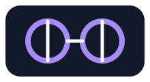

<p align="center"></p>
<p align="center"></p>
<p align="center"><a href="LICENSE"></a>   </p>
<p align="center"></p>

## 🧭 Overview
Inspect browser performance entries and create User Timing marks and measures. The app runs locally and uses native browser APIs; no account or remote service is required.

## ✨ Features
- ⏱️ Observe supported navigation, resource, paint, mark, and measure entries
- 🧪 Create a named mark pair and measure its duration
- 🧭 Display supported entry types so browser differences are explicit

## 🎬 Demo
Start the local server and interact with the controls. No hosted demo is claimed.

## 🚀 Quick Start
```bash
npm start
```
Open http://localhost:4173.

## 🧰 Tech Stack
- 🧩 Node.js and browser JavaScript
- 🔒 Local-first; no telemetry or API key
- 📦 No runtime dependencies

## 🗂️ Folder Structure
```text
browser-performance-observer-lab/
├── assets/mark.svg
├── public/{index.html,styles.css,app.js}
├── server.js
├── package.json
├── .gitignore
├── LICENSE
└── README.md
```

## 🛣️ Roadmap
- [ ] Add more guided examples
- [ ] Export a session summary as JSON

## 🤝 Contributing
Issues and pull requests are welcome. Keep examples reproducible and document browser support.

## 📄 License
Released under the [MIT License](LICENSE).

<p align="center"></p>